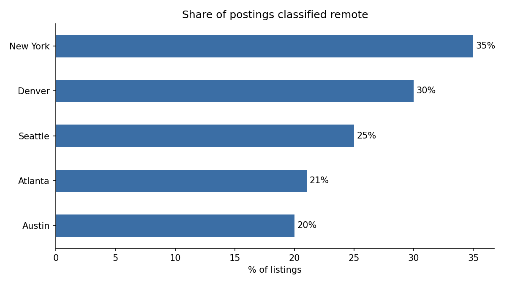
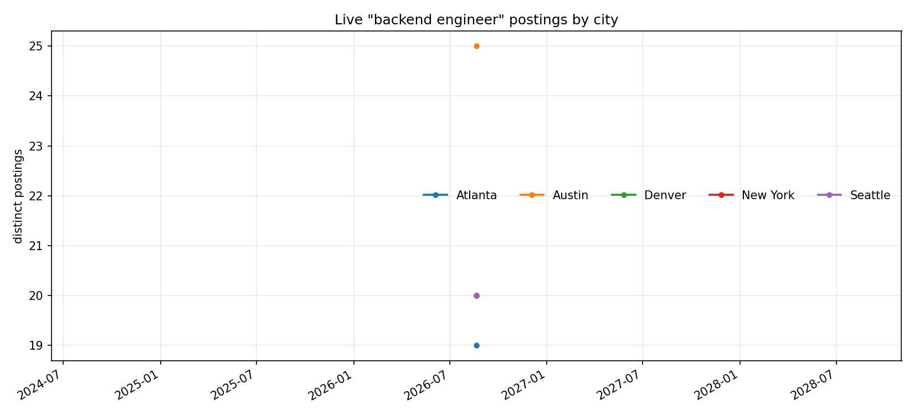
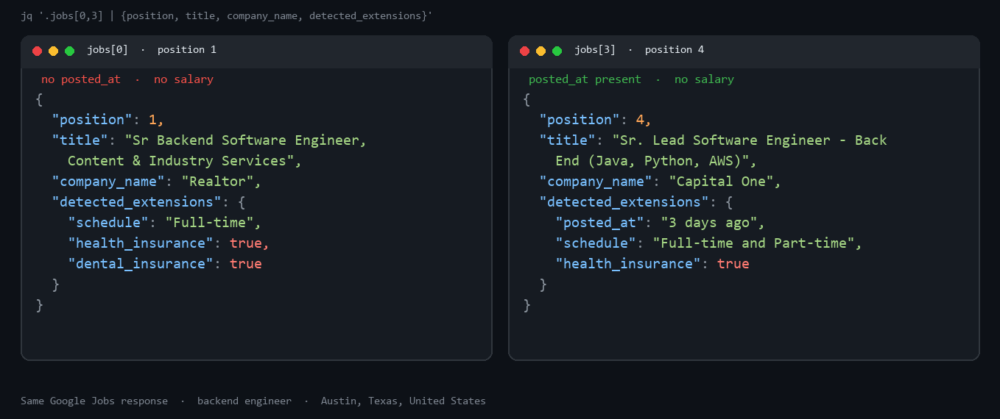

<div align="center">


<br />
<br />

# Google Jobs Snapshot Tracker

### Daily Google Jobs snapshots stored in SQLite and charted over time

A Python collector that snapshots Google Jobs postings for one role across several cities with the SearchApi Google Jobs API, stores one row per job per day in SQLite, and charts how the market changes.

<br />

[![Built by Studio1](https://img.shields.io/badge/Built_by_Studio1-f97316?style=for-the-badge&logo=data%3Aimage%2Fsvg%2Bxml%3Bbase64%2CPHN2ZyB4bWxucz0iaHR0cDovL3d3dy53My5vcmcvMjAwMC9zdmciIHZpZXdCb3g9IjAgMCAxNjAgMTYwIiBmaWxsPSJub25lIj48cGF0aCBmaWxsLXJ1bGU9ImV2ZW5vZGQiIGNsaXAtcnVsZT0iZXZlbm9kZCIgZD0iTTAgMzVDMCAxNi42ODA3IDE0LjA3NDQgMS42NDg0NCAzMiAwLjEyNjk1M1YxNDFINTEuMDUyM0M1Mi40MzA4IDEzNy4zNDQgNTQuNzQ0NiAxMzMuNjg5IDU3Ljk5MzggMTMwLjAzM0M2MS4xNDQ2IDEyNi41MDggNjQuNjg5MiAxMjMuNDQgNjguNjI3NyAxMjAuODI5QzcyLjU2NjIgMTE4LjM0OSA3Ni4zNTY5IDExNi43ODIgODAgMTE2LjEyOVY4Ni43NTQ0Qzc1LjQ3MDggODcuOTI5MiA3MS4zODQ2IDg5LjY5MTkgNjcuNzQxNSA5Mi4wNDE1QzY0IDk0LjUyMjUgNjAuNzUwOCA5Ny40NiA1Ny45OTM4IDEwMC44NTRDNTYuNTM0NSAxMDIuNzIgNTUuMjU0NSAxMDQuNjU5IDU0LjE1MzkgMTA2LjY3MVYwSDEyNUMxNDQuMzMgMCAxNjAgMTUuNjY5OSAxNjAgMzVWMTI1QzE2MCAxNDQuMzMgMTQ0LjMzIDE2MCAxMjUgMTYwSDEyNFYxOEgxMDQuOTQ4QzEwMy41NjkgMjEuNjgxNiAxMDEuMjU1IDI1LjM2MjggOTguMDA2MiAyOS4wNDQ0Qzk0Ljg1NTQgMzIuNTk0MiA5MS4zMTA4IDM1LjY4NDEgODcuMzcyMyAzOC4zMTRDODMuNDMzOCA0MC44MTIgNzkuNjQzMSA0Mi4zODk2IDc2IDQzLjA0NzRWNzIuNjMwNEM4MC41MjkyIDcxLjQ0NzMgODQuNjE1NCA2OS42NzI0IDg4LjI1ODUgNjcuMzA1N0M5MiA2NC44MDc2IDk1LjI0OTIgNjEuODQ5MSA5OC4wMDYyIDU4LjQzMDdDOTkuNDY1NSA1Ni41NTEzIDEwMC43NDUgNTQuNTk4NiAxMDEuODQ2IDUyLjU3MjNWMTYwSDM1QzE1LjY3IDE2MCAwIDE0NC4zMyAwIDEyNVYzNVoiIGZpbGw9IiNmZmZmZmYiLz48L3N2Zz4K)](https://studio1hq.com)
[](https://www.searchapi.io)
[](https://www.searchapi.io/docs?utm_source=Dev&utm_medium=Ambassador&utm_campaign=studio1hq.com)

[SearchApi docs](https://www.searchapi.io/docs) &nbsp;·&nbsp; [SearchApi](https://www.searchapi.io) &nbsp;·&nbsp; [More examples](https://github.com/Studio1HQ) &nbsp;·&nbsp; [studio1hq.com](https://studio1hq.com)

</div>

<br />

## Overview

Job boards show what is open today and forget it tomorrow. This collector builds the history yourself: it snapshots Google Jobs postings for one role across several cities every day, writes one row per job per day to SQLite, and charts how the market composition moves. The difference between yesterday and today becomes queryable.

Data comes from the [SearchApi Google Jobs API](https://www.searchapi.io/docs/google-jobs?utm_source=Dev&utm_medium=Ambassador&utm_campaign=studio1hq.com).

<p align="center"></p>

<details>
<summary>More charts</summary>

<p align="center"></p>
<p align="center"></p>

</details>

## Features

- **Multi-city fetch**: pulls Google Jobs results for one query across a list of cities, walking token-based pagination.
- **Field normalization**: handles the three fields that resist analysis, which are relative posting dates, work mode and free-text salary.
- **Deduplication**: uses Google's own `htidocid`, since the API returns no `job_id`.
- **Daily history**: one row per job per snapshot date, so listing lifespan and daily churn fall out of the data.
- **Remote-share chart**: rendered with sample sizes on the bars.
- **Idempotent runs**: `INSERT OR REPLACE` means a re-run after a partial failure repairs the day instead of duplicating it.
- **Scheduled collection**: a cron line or the included GitHub Actions workflow, which commits the database back to the repo.
- **Dashboard**: `dashboard.py` is a Streamlit app over the same database.

## Tech stack

| Layer | Tool |
| --- | --- |
| Language | Python 3.11+ |
| Data source | [SearchApi Google Jobs API](https://www.searchapi.io/docs/google-jobs?utm_source=Dev&utm_medium=Ambassador&utm_campaign=studio1hq.com) |
| Storage | SQLite (`jobs.db`) |
| Analysis | pandas, matplotlib |
| Dashboard | [Streamlit](https://streamlit.io) |
| Scheduling | cron or GitHub Actions |

## Getting started

### Prerequisites

- Python 3.11 or later, because the code uses `datetime.UTC` and PEP 604 type hints.
- A [SearchApi account](https://www.searchapi.io/?utm_source=Dev&utm_medium=Ambassador&utm_campaign=studio1hq.com) for an API key. The free tier includes 100 searches, which covers setup and debugging.

### Installation

```bash
git clone https://github.com/Studio1HQ/Job-market-tracker.git
cd Job-market-tracker
python -m venv venv
source venv/bin/activate          # Windows: venv\Scripts\activate
pip install -r requirements.txt
```

### Environment variables

| Variable | Description |
| --- | --- |
| `SEARCHAPI_KEY` | Your SearchApi key. Read at request time rather than at import, so `analyze.py` and the tests run without one. |

```bash
export SEARCHAPI_KEY="your_key_here"      # Windows PowerShell: $env:SEARCHAPI_KEY="your_key_here"
```

### Configuration

Edit two constants at the top of `tracker.py`:

```python
CITIES = [
    "Austin,Texas,United States",
    "Denver,Colorado,United States",
    "Seattle,Washington,United States",
    "Atlanta,Georgia,United States",
    "New York,New York,United States",
]
QUERY = "backend engineer"
```

Use fully qualified location strings. Passing `"Austin"` and `"Austin,Texas,United States"` can resolve to different places, and a silent change mid-series looks like a demand shift in your charts. Every run logs the `location_used` value the API resolved, so watch it for drift.

### Run

Start with the cheapest check, which costs one search and confirms your key works and rows land in the database:

```bash
python tracker.py --one-city --max-pages 1
```

Run a full snapshot across every configured city:

```bash
python tracker.py
```

Generate the chart from whatever snapshots exist:

```bash
python analyze.py
```

Output lands in `images/remote_share.png`. The script selects matplotlib's Agg backend, so it runs headless under cron and CI, and it exits cleanly against an empty database.

| Flag | Default | Purpose |
| --- | --- | --- |
| `--one-city` | off | Fetch only the first entry in `CITIES`, for cheap smoke tests |
| `--max-pages N` | 2 | Pages per city. Each page returns about 10 results, so this sets your ceiling |

### Scheduling

Snapshot at a consistent hour so each run samples a comparable point in the posting cycle. This cron entry runs at 06:15 daily and appends output to a log:

```cron
15 6 * * * cd /home/you/jobtracker && /usr/bin/env SEARCHAPI_KEY=xxx ./venv/bin/python tracker.py >> run.log 2>&1
```

GitHub Actions also works. `.github/workflows/snapshot.yml` commits the database back to the repo after each run, which gives free hosting and a version history of every snapshot. Add `SEARCHAPI_KEY` under Settings, Secrets and variables, Actions.

Scheduled runners drift by up to an hour under load and skip entirely during outages, so expect gaps and plot against actual snapshot dates.

### Tests

39 unit tests cover the parsers, the pagination retry loop, the dedup key and the schema round trip. No API key or network access is required.

```bash
pytest tests/ -v
```

## How it works

### Data model

The table holds one row per job per snapshot date, keyed on `(snapshot_date, city, query, job_key)`.

| Column | Notes |
| --- | --- |
| `snapshot_date` | Date the row was collected. The only date you can fully trust |
| `job_key` | `htidocid` from `sharing_link`, or a SHA-1 of title, company and location as fallback |
| `query`, `city` | The search that produced the row |
| `title`, `company`, `location`, `via` | Straight from the API |
| `posted_at_raw` | Original relative string, kept for re-parsing |
| `posted_date` | Absolute date derived from the snapshot date |
| `posted_precision` | `day`, `approx`, `floor`, `missing` or `unparsed` |
| `work_mode` | `remote`, `hybrid`, `onsite` or `unknown` |
| `schedule` | Full-time, contract and so on |
| `salary_raw` | Original salary string, so parser fixes can be applied retroactively |
| `salary_min`, `salary_max` | Annualized USD |
| `salary_source` | `detected_extensions` or `description` |
| `position` | Rank in the API response. Useful for spotting collector artifacts |

`CREATE TABLE IF NOT EXISTS` skips existing tables, so adding a column to `SCHEMA` does nothing to an older database. `migrate()` runs on every snapshot, checks `PRAGMA table_info`, and issues `ALTER TABLE` for anything missing. Existing history survives, and databases created before `salary_raw` existed are upgraded on the next run.

### Parsers

**Posting dates.** Google returns relative text such as `3 days ago`, `Just posted` or `30+ days ago`. Each string only means something relative to the fetch time, which is why the snapshot date is stored on every row. `posted_precision` records how far to trust the derived date, and `30+ days ago` is a floor, not a date. About 17% of listings carry no `posted_at`, so those rows get `missing`.

**Work mode.** Three signals are layered, cheapest first: the `work_from_home` flag, then the location string, then the first 2,000 characters of the description. HTML is stripped before that window is measured, since tags consume about 7% of the budget. `ONSITE_HINT` and `HYBRID_HINT` are deliberately separate, so "you will work onsite with the platform team" does not classify as hybrid.

**Salary.** Two passes with different strictness. The structured `detected_extensions.salary` field is known to hold a salary, so a currency symbol is optional there (Google writes values like `125K a year`). Free description text keeps the `$` anchor so version numbers and dates do not match as money. `NON_USD` rejects £, €, ¥, ₹, the EUR, GBP, CAD, AUD and INR codes, and `C$`, `A$`, `CA$`, `AU$`, `NZ$`.

What the salary parser still gets wrong:

| Input | Result |
| --- | --- |
| `$55 - $70 an hour` | Annualized at 2,080 hours, wrong for part-time or short contracts |
| `Up to $180,000 a year` | A ceiling recorded as a point value |
| `Equity grant of $2,000 - $8,000. Base salary $140,000 - $170,000.` | Discarded, because equity wins the regex race and then fails the sanity floor |

### Cost

Quota use is `cities × queries × pages × days` searches per month. The default 5-city, single-query, 2-page daily run is 300 searches, 3% of SearchApi's Developer plan. Billing is by monthly plan, not per call. Only successful requests count, so a rate-limited retry costs time rather than quota. The hourly cap is 20% of the monthly allocation. See the [SearchApi pricing page](https://www.searchapi.io/pricing?utm_source=Dev&utm_medium=Ambassador&utm_campaign=studio1hq.com).

### Known limitations

- **Pagination caps your counts.** Each page returns about 10 results, so `max_pages` sets a hard ceiling per city. Raise it until cities come back under the ceiling, or treat counts as a fixed-depth sample.
- **Coverage varies by region.** Google Jobs aggregates from job boards, so counts across countries are not comparable.
- **Reposted listings inflate counts.** A refreshed posting can surface with a new `htidocid`, so the dedup key treats it as new.
- **Ranks are not meaningful.** Result order is personalized and location-derived. Counts are reliable, ranks are not.
- **Non-USD markets are dropped, not converted.**

### What the first snapshot showed

A single run across five cities on 2026-08-21 returned 104 postings.

| City | Live postings | Remote | Hybrid | Onsite | Unknown |
| --- | --- | --- | --- | --- | --- |
| Atlanta | 19 | 21% | 16% | 11% | 53% |
| Austin | 25 | 20% | 4% | 8% | 68% |
| Denver | 20 | 30% | 10% | 0% | 60% |
| New York | 20 | 35% | 5% | 0% | 60% |
| Seattle | 20 | 25% | 15% | 0% | 60% |

Percentages are rounded, so Atlanta sums to 101%. Remote percentages rest on 4 to 7 listings per city, where one posting moves the number by 4 to 5 points, so the gap between New York and Austin carries no weight. The `unknown` majority means most listings describe their work arrangement nowhere in the first 2,000 characters: remote is 20% to 35% of all listings but 44% to 88% of listings the classifier could place.

Austin's 25 is a collector artifact. Every Austin row has a `position` between 1 and 10, so a smoke test and a full two-page pull landed on the same date. Salary disclosure measured 9% on that snapshot under the earlier `$`-anchored parser that rejected every unsigned amount, so treat it as a floor.

### Project layout

```text
.
├── tracker.py                    # fetch, normalize, store
├── analyze.py                    # queries and the remote-share chart
├── dashboard.py                  # Streamlit dashboard
├── tests/test_tracker.py         # parser unit tests, no API key needed
├── requirements.txt
├── images/                       # chart output
├── jobs.db                       # created on first run
└── .github/workflows/snapshot.yml
```

## Resources

- [SearchApi Google Jobs API](https://www.searchapi.io/docs/google-jobs?utm_source=Dev&utm_medium=Ambassador&utm_campaign=studio1hq.com): the data source and its parameters.
- [SearchApi docs](https://www.searchapi.io/docs?utm_source=Dev&utm_medium=Ambassador&utm_campaign=studio1hq.com): API reference.
- [SearchApi pricing](https://www.searchapi.io/pricing?utm_source=Dev&utm_medium=Ambassador&utm_campaign=studio1hq.com): plan limits and rates.

<br />

---

<div align="center">

<a href="https://studio1hq.com">
  <picture>
    <source media="(prefers-color-scheme: dark)" srcset="https://raw.githubusercontent.com/Studio1HQ/website/main/brand/studio1-logo-on-dark.svg" />
    
  </picture>
</a>

Built by **[Studio1](https://studio1hq.com)**, the technical content and DevRel partner for devtool teams. Made with [SearchApi](https://www.searchapi.io).<br />
Browse more open-source examples at [github.com/Studio1HQ](https://github.com/Studio1HQ).

[](https://studio1hq.com)
[](https://cal.com/studio1/collab)
[](https://x.com/Studio1HQ)
[](https://www.linkedin.com/company/studio1hq/)

<sub><a href="https://studio1hq.com">studio1hq.com</a> · Technical content, docs, video and DevRel for devtools</sub>

</div>
